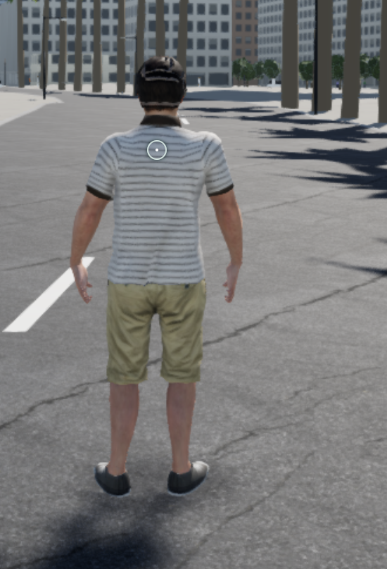
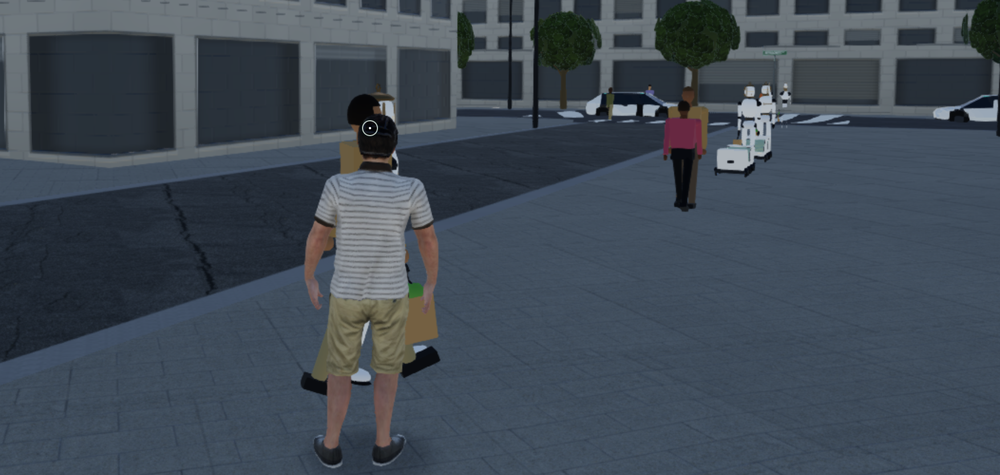
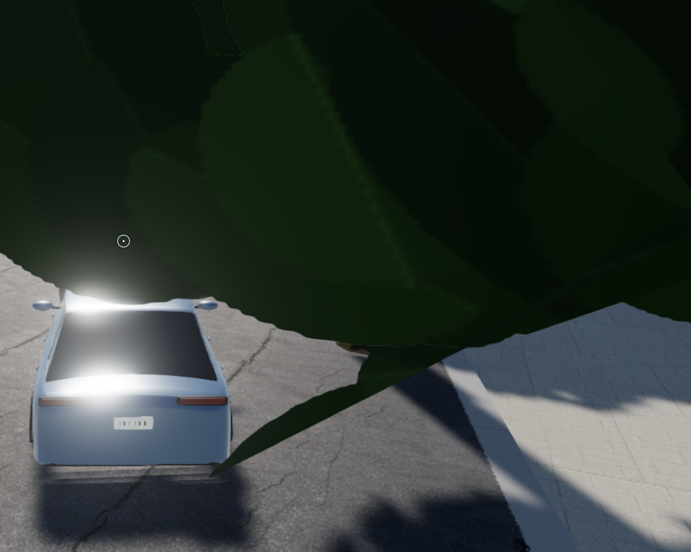
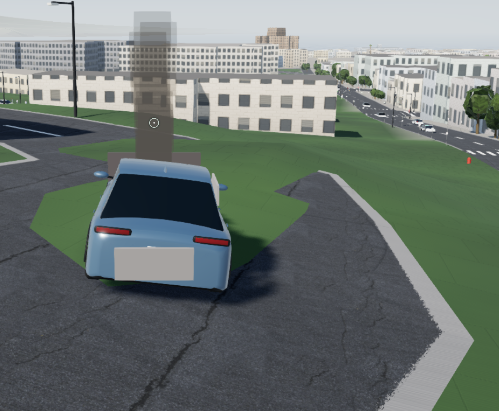
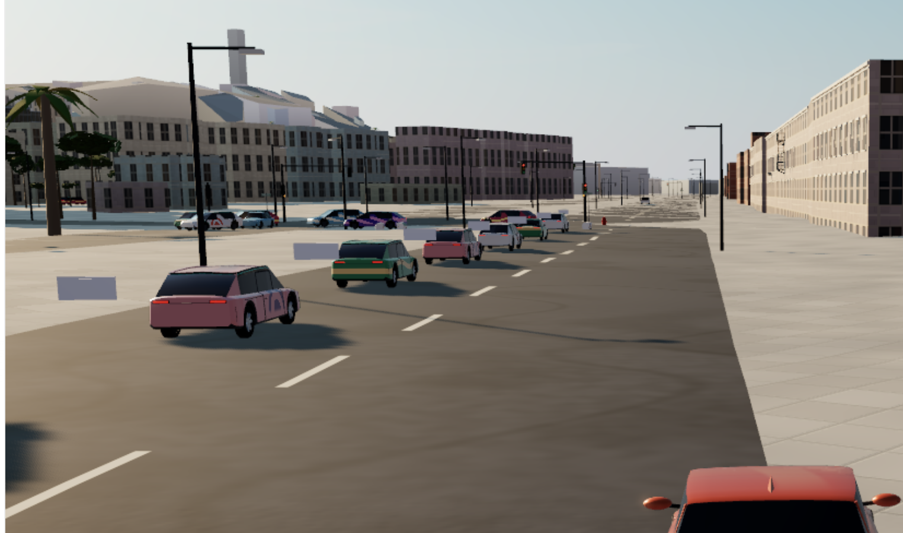
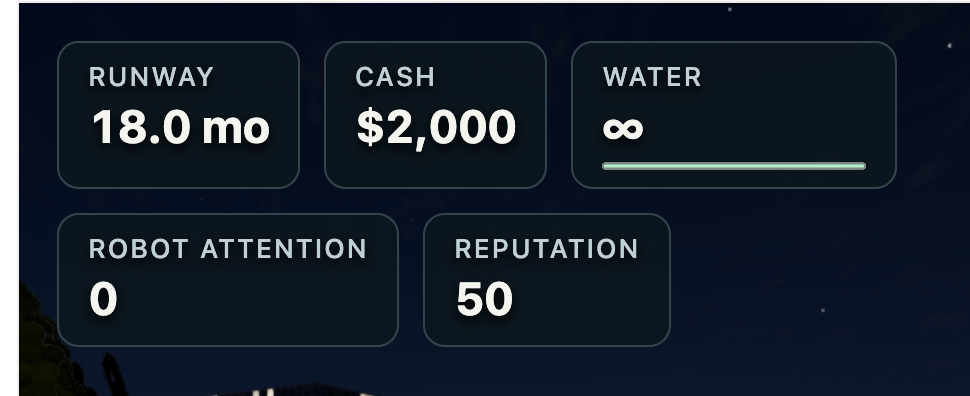
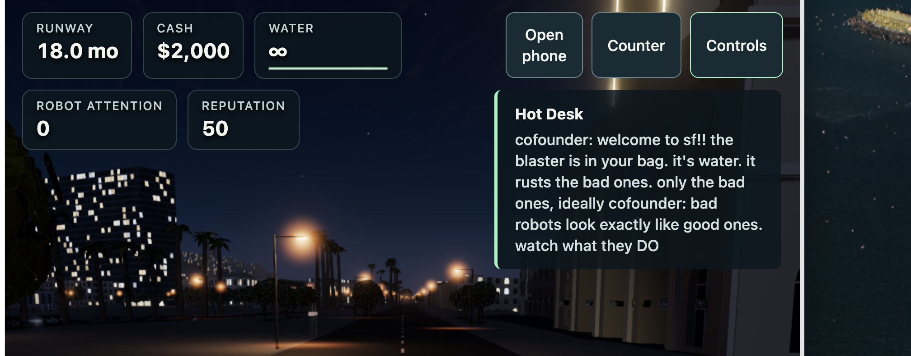
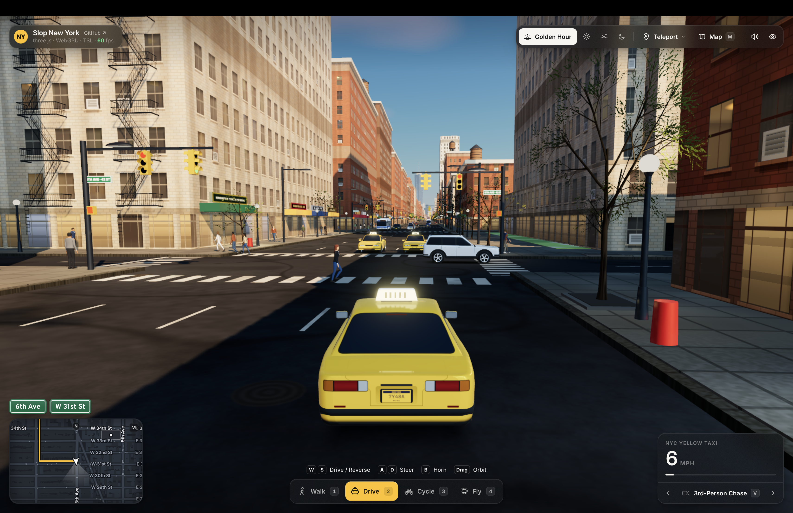
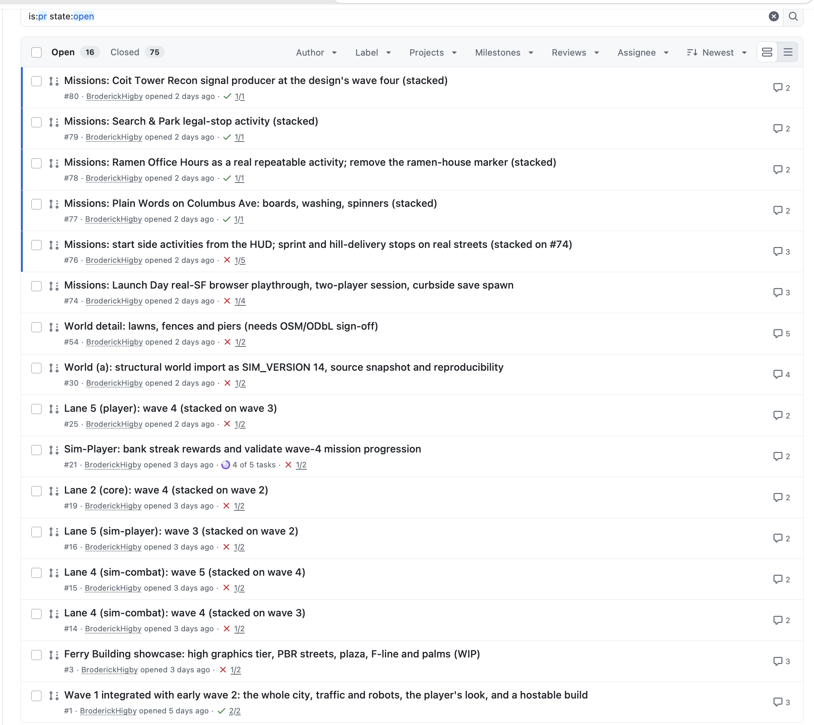
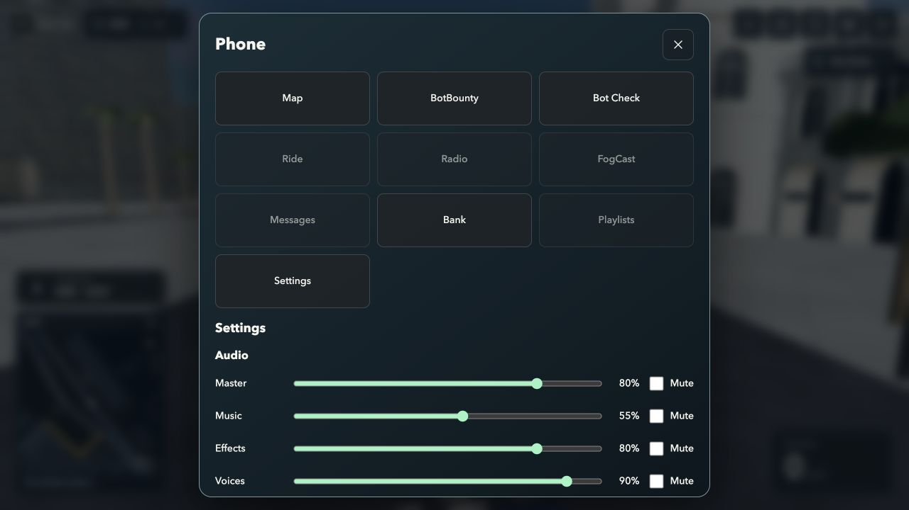

# Owner-provided bug examples and visual references

These are the original screenshots sent in the conversation, copied without
resizing or editing. They document what the owner reported at the time. **They
are not a claim that every pictured defect still exists on current main.**
Some fixes have already landed, especially the compact HUD. Reproduce the
relevant case on the current baseline, preserve existing fixes, and include it
in final regression QA. Do not recreate a defect merely to match an old image.

Open `GALLERY.html` for a portable visual index. `IMAGE_MANIFEST.json` records
the original filenames, dimensions and SHA-256 hashes. Images also live in
`images/`, so they remain available offline on the receiving computer.

## 1. Reticle showing over the player

The owner said there should not be a dot over the character while simply
running. Preserve the contextual aiming indicator: ordinary running/walking
should not show it, while aiming/spraying/scanning may show appropriate feedback.

## 2. People reverting to the old avatars

The owner reported nearby people changing back to the simple block figures.
Preserve the authored human characters, identities, textures and animation as
the camera moves and detail tiers change. Check foot grounding separately;
an image of a character is not proof that its moving feet stay above the road.

## 3. Trees obstructing a street and the driving camera

The owner said trees should not be in the streets. Validate trunk placement
against drivable road space, and check the follow camera near canopies. Keep
appropriate roadside vegetation without planting it in traffic lanes.

## 4. Grass over pavement

The owner reported grass covering roads and pavement. Preserve the existing
road, curb, path, building and water exclusions; turf should be constrained to
actual lawn areas and follow their support surface.

## 5. Detached rectangular car panels

The owner described weird bumpers in front of cars. Check that damage/body
panels stay attached in the correct vehicle-local frame while cars move, turn
and change detail tiers. No floating rectangles should remain around traffic.

## 6. Oversized stat cards

The owner asked for icons and disclosure rather than a smaller copy of the
large dashboard. This was addressed by [PR106](https://github.com/BroderickHigby/fog-city/pull/106). Preserve the compact status strip,
contextual warnings and accessible, optional five-stat explanation panel.

## 7. HUD buttons and mission text consuming the screen

The owner showed the full combination of cards, large buttons and an always-open
mission paragraph. [PR106](https://github.com/BroderickHigby/fog-city/pull/106) makes controls icon-based and mission detail optional.
Keep the city visible, retain accessible hit targets, and preserve Continue,
keyboard/gamepad navigation and narrow/touch layouts.

## 8. Visual reference: Slop New York

This is an inspiration image, **not a Fog City bug screenshot**. It explains
the requested street-level visual richness, traffic, lighting and map treatment.
The owner explicitly wants San Francisco and the existing characters retained.
Use the project's licensed/attributed source study; do not import NYC geography
or treat this image as permission to reuse unrelated third-party assets.

## 9. Historical PR-list context

This screenshot explains the request to consolidate unfinished PR work. It is
historical UI, not the current GitHub state. Read `PR_INVENTORY.md` and refresh
the live PRs before making any merge or supersession decision.

## Additional current audit image: phone settings

This last image was captured by the assistant during the handoff audit, not
uploaded as an original bug example. It shows the existing large phone modal
and Audio settings. The live UI also has saved-progress controls; a Graphics
selector is absent. This is the starting point for the requested phone redesign
and Auto/Low/Standard/High selector.

## Other reported issues without a corresponding supplied screenshot here

- Cars starting in water or absorbing into one another.
- Feet sinking into asphalt, incorrect foot direction and desired running speed.
- High-pitched synthetic driving noise.
- Hard-to-identify hostile robots, unfinished phone apps and missing spoken story.

Keep these as explicit regression or implementation tasks. Do not invent image
evidence for them. The full handoff and priority checklist describe acceptance.
