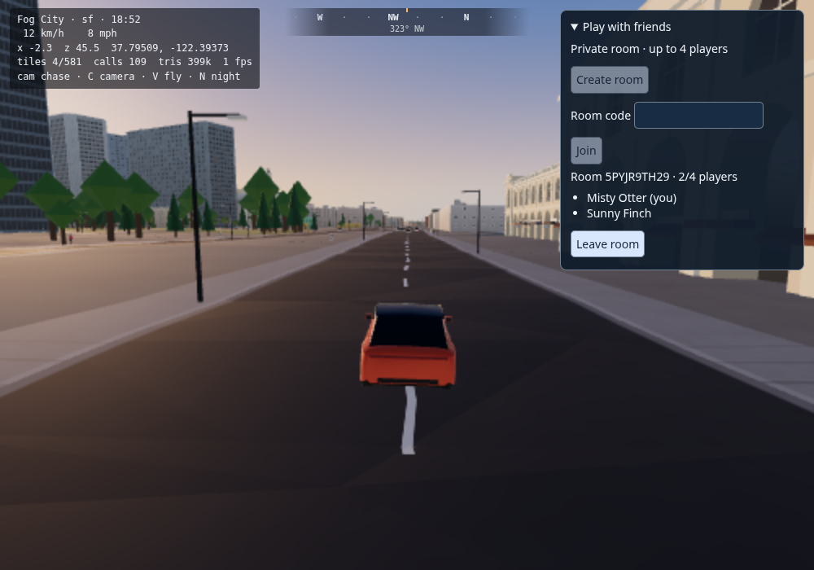

# Independent multiplayer review

The independent pass exercised nine files / 48 tests covering the input protocol, real
loopback relay, rollback, world identity, replay and merged surface/dodge behavior. Those
checks passed. It found one additional client lifecycle defect outside the lobby's current
fresh-client flow.

## Reconnecting an existing client to a new room

A welcome for a new room reset the input sequence but retained the old confirmed state.
After room seed 11 reached tick 120, a welcome for room seed 22 at tick 0 was incorrectly
treated as a stale snapshot. The client could report connected while still simulating the
previous room.

The welcome boundary now clears the previous confirmed/predicted state, roster, recovery
flag and correction count before validating the new snapshot. The regression in
`tests/net/prediction.test.ts` uses two real Room instances and verifies the new seed, tick,
hash, empty pending queue and reset input sequence. It failed on the old implementation
with `expected 11 to be 22`, then passed with the fix.

After that repair, all 57 network/control/harness tests across eight files passed. The
earlier two-context Chromium checks on both dev and SF, plus the container health and room
handshake, are recorded in `2026-10-23-multiplayer-foundation.md`.

## Scope and remaining gates

This review found no other validated multiplayer regression. It does not establish that
the full game, all modes, the world-continuity gate, or public-service deployment is ready.
Known world-data failures and regeneration requirements remain in
`2026-10-23-integration-status.md`. Bot Sweep and subsequent modes still need their owning
lanes' contracts and implementation.

The SF screenshot shows the verified two-player lobby and running city. Visual quality
and performance on real hardware remain for the owner to judge.

## Broader checks and visual sample

All eight Firefox/WebKit pure-simulation comparisons against Node passed. The full unit/world
run finished with 3,062 passed, 92 failed and one maintenance test pending; see
`2026-10-23-full-suite-triage.md` for exact failures, attribution and ownership. The world
baseline description adjustment preserves every threshold and failing-run list.

The two-player SF and single-player packed-SF screenshots show readable lobby text, matching
roster counts and visible roads, sidewalks, buildings, trees and the player car, without an
obvious overlap in these two views. The remote car is not visible in the two-player still;
movement/synchronization evidence comes from the browser assertions, not the screenshot.
The developer HUD remains prominent and the invitation panel has no copy/share action;
those are future UI refinements. These samples do not validate other districts, frame rate
or the final visual direction.
