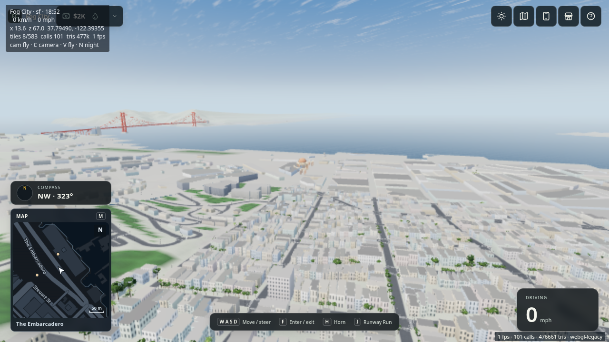
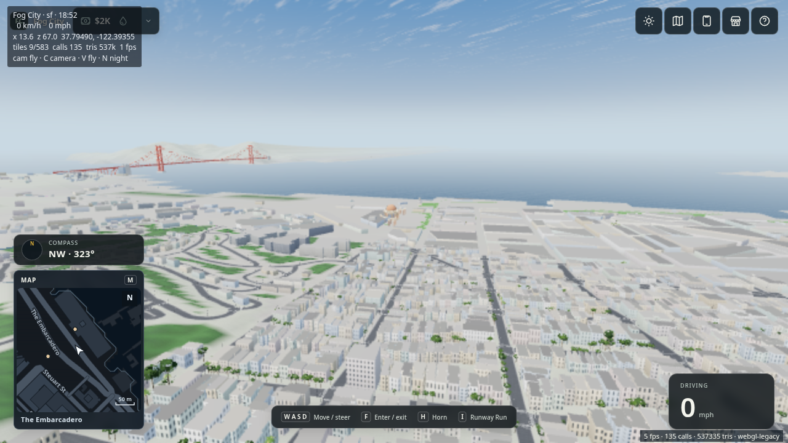

# Persistent mapped lawn coverage — October 31–November 1, 2026

[PR #139](https://github.com/BroderickHigby/fog-city/pull/139) fixes mapped lawns turning gray when nearby detail is absent or outside its 550 m selection radius. Small lawns can fall entirely inside the distant terrain’s 100 m triangles, so vertex-only tinting does not represent them.

## Change

The pinned DataSF Lawn polygons partition each loaded ground triangle into disjoint grass and neutral faces. They share the original terrain plane; there is no overlapping second floor. Existing holes, roads/sidewalks, building footprints, low shoreline water and the Palace lagoon remain excluded. Integer clipping uses a 0.1 mm grid to avoid failures at almost-coincident projected edges.

Near GLTFs, distant cells and collider fallback terrain await cooperative preparation before admission. Work yields between triangles, polygon operations and buffer-copy chunks, and commits buffers atomically. Unloaded/disposed records cancel without becoming visible. Far seam extraction happens before partitioning; each completed cell publishes its own final counts. Detailed turf/blade limits are unchanged. Optional lawn loading still permits boot when the data is absent. No simulation, collision, geographic data, save version or multiplayer contract changes.

## Cloud verification

The user prohibited launching the game locally. No local game, browser, dev server, tests, build or dependency install was run. Execution used a temporary Vercel Sandbox with 4 vCPUs, 8 GiB memory, Node 24.22.1 and pnpm 9.12.0. Browser captures use Chromium/SwiftShader, which does not establish hardware frame rate.

At game-code commit [c88c96ca](https://github.com/BroderickHigby/fog-city/commit/c88c96ca78a03667525fb7783b10527aa3c58d15):

- Typecheck passed.
- All **738 tests in 88 render/I/O files passed**, including polygon area conservation, holes, pavement, shoreline clipping, original plane/attributes, finite draw ranges, material groups, resumable commit, near/far cancellation, missing/failed GLB fallback admission and unload disposal.
- The packed static build passed: 226 files, 160.3 MB, within the existing host limits. Its existing large-bundle warning remains.
- Independent Standards and Spec source reviews passed at that exact pushed game-code commit. Later evidence-only changes do not change the game code.

Reproduce in cloud/CI with the full tracked assets and installed dependencies:

```sh
pnpm typecheck
pnpm exec vitest run tests/render tests/io --maxWorkers=1
pnpm build
node scripts/bench/lawn-terrain.ts lawn-geometry.json
```

## Citywide geometry

The geometry audit loads every far GLB and every near GLB whose bounds intersect a mapped lawn: **235 meshes**. It also admits all 33 distant cells through the actual `FarLayer`, including seam stitches and aprons, without the landmark hull filter (a conservative count).

| Measurement | Result |
| --- | ---: |
| Original far GLB triangles | 467,343 |
| Partitioned far GLB triangles | 573,220 |
| Admitted far triangles, including stitches/aprons | **577,484** |
| Existing far limit | 600,000 |
| Far cells loaded / failed | 33 / 0 |
| Seam edges | 106 |
| Added near terrain triangles across audited meshes | 176,254 |
| Geometry-audit peak RSS, without browsers | 803 MiB |

These are asset/admission counts, not simultaneously visible frame counts. With no browser or test process running, a follow-up measured 30.8 s total cooperative preparation over all 235 meshes, 1.61 s maximum elapsed per mesh (including yields), 80.0 ms maximum event-loop heartbeat gap and 333 ms one-time lawn/mask setup. Individual clipping operations are not interruptible, so the 2 ms scheduling target is not a worst-case deadline. This audit ran while two software browsers were active: 41.3 s total preparation over all 235 meshes, 2.68 s maximum elapsed time for one mesh (with yields), 112.2 ms maximum event-loop heartbeat gap and 797 ms one-time lawn/mask setup. A previous asynchronous run under lighter concurrent load recorded a 53.6 ms maximum heartbeat gap. Those are contended cloud measurements, not a 2 ms worst-case guarantee or hardware FPS claim. Individual clipping/triangulation calls and typed-array allocation remain indivisible.

## Release holds

The broad game sweep and security findings are recorded in [the security and bug audit](2026-10-31-security-bug-audit.md). Three unchanged simulation checks failed, including an isolated allocation-budget rerun; complete `pnpm verify` is not green. No performance baseline was loosened. This PR remains draft and is not merged or deployed.

## Browser checks

The unmodified selected Chromium suite covered [dev-world](https://github.com/BroderickHigby/fog-city/blob/c88c96ca78a03667525fb7783b10527aa3c58d15/tests/e2e/dev-world.spec.ts), [graphics-recovery](https://github.com/BroderickHigby/fog-city/blob/c88c96ca78a03667525fb7783b10527aa3c58d15/tests/e2e/graphics-recovery.spec.ts), [sf-world](https://github.com/BroderickHigby/fog-city/blob/c88c96ca78a03667525fb7783b10527aa3c58d15/tests/e2e/sf-world.spec.ts) and [web-build](https://github.com/BroderickHigby/fog-city/blob/c88c96ca78a03667525fb7783b10527aa3c58d15/tests/e2e/web-build.spec.ts): **15 passed, 2 failed, 8 did not run**, in 17.6 minutes. All development-world control/pause/camera checks and automatic graphics recovery passed. SF booted and drew without console errors. Both binary and split/text build file-limit tests passed; the split/text build booted SF, drove more than 30 m and passed missing-part failure handling.

The failures remain open:

1. The real-city Ferry camera did not reach `tilesSettled()` within its existing 80-second deadline. Its serial follow-up cases did not run.
2. The binary packed build booted SF and loaded the on-foot avatar, then exceeded the 180-second test deadline while waiting for `surfaceTextures.length === 2` after returning to the car. Its subsequent streaming test did not run. This is not evidence that binary boot itself failed. The cause and baseline reproduction remain unverified.

These are unmodified test failures under concurrent SwiftShader cloud load. No test deadline, assertion or baseline was loosened. They are not claimed to be caused by, or independent of, the lawn patch without baseline evidence.

The strict daytime capture saved four completed views (Ferry facade, Marina Green, downtown aerial and Palace aerial), each below 1,500 calls / 3M visible triangles / 600k far triangles, with zero failed tiles and no page/console/HTTP errors. The subsequent Ferry boundary and separate distant captures did not settle within 180 seconds. An automatic-backend capture also timed out waiting for settling. Their timeouts remain recorded independently from successful views.

Additional visual captures explicitly warm street detail via its existing budgeted `update()` routine between paused cloud render frames, using a 20 ms preparation budget and requested `pr=0.25` (the renderer applies its 0.5 minimum), then wait for normal readiness and capture. This changes the external capture harness only; it does not change game source or turn unmodified browser-test failures into passes. SwiftShader timing is not a hardware result. Matched baseline and warm-return evidence are supplementary to the above checks.


## Matched distant view and warm return

The following views use identical cameras, viewport, requested graphics and pinned noon lighting. The Palace lawns are more than 550 m from the distant camera, outside nearby turf detail. Both source revisions use unchanged tracked assets. The baseline comparison checkout shares those unchanged assets and metadata with the candidate; the game source itself is pinned separately. Paused simulation ticks are not asserted identical.

| Before: baseline f1147ea1 | After: game code c88c96ca |
| --- | --- |
|  |  |

The warmed candidate sequence completed Palace golden-hour → Marina Green → Palace noon return → distant Palace. The matched baseline completed distant Palace → Palace aerial. All six warmed captures settled, with no failed tiles or page/console/HTTP errors. Grass stayed within 35 patches, 2 calls, 7,772 surface triangles and 7,294 blade triangles in those views. Maximum warmed candidate frame: 135 calls / 537,335 triangles, below the existing 1,500 / 3M limits.

On the Palace return, the frame returned to exactly 131 calls / 361,492 triangles and shader programs stayed at 34. Geometries increased by 12 and textures by 1 across that one return (within the existing +64/+8 capture allowances); retained far cells and newly warmed assets make this one bounded observation, not a long-running leak proof. Building detail was no longer pending in all warmed captures.

[Machine-readable evidence](grass-coverage-20261031/evidence.json) contains the exact camera, render, grass and resource counters, scoped advisory result and geometry summary. Original strict-capture timeouts and unmodified browser-test failures remain release holds regardless of successful warmed captures.
