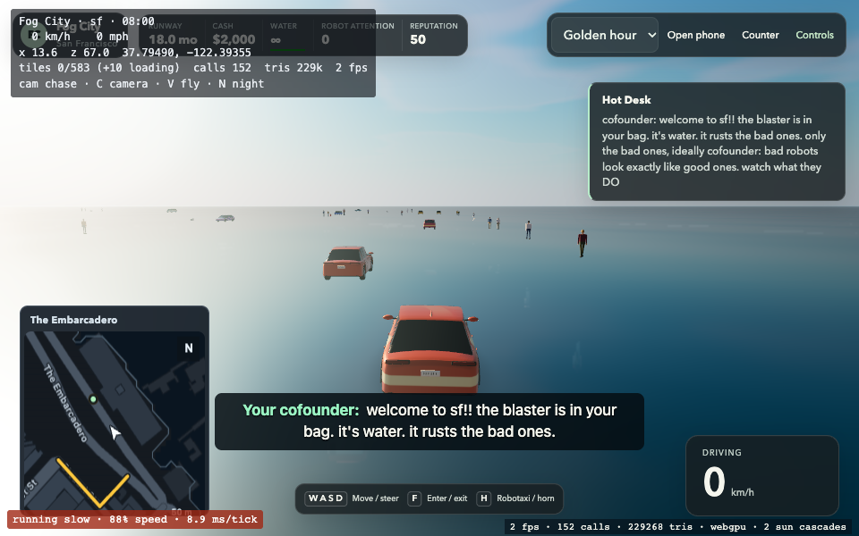
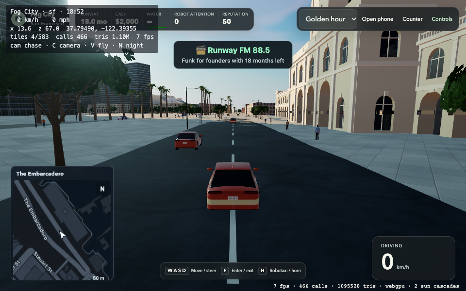

# Keep the starting street visible when the game opens

The reported cars-in-water startup was reproduced on the released build by delaying the four nearby packed tile requests. It advertised `ready: true` and exposed cars, people and the ocean with zero loaded street tiles and ten pending. Releasing the same requests restored dry streets without changing the car's coordinates. The fresh SF car was already correctly placed at `(13.59, 3.17207, 66.97)`, on dry ground; relocating the spawn would not repair the loading race.

The game now stays behind a loading screen until the nearby street tiles are actually ready and have passed through two rendered frames. The renderer continues loading behind the screen, while simulation and controls remain stopped. The fixed-step clock resets on release, so download time does not become a burst of physics updates. Distant scenery can continue streaming without blocking the first street. A 45-second bound presents a Retry button instead of exposing an unfinished scene. A graphics-recovery save is resolved before choosing the initial view; its pending recovery marker survives failure and Retry, clearing only when the street is ready.

This changes presentation startup, not geography or simulation: no spawn coordinates, physics, SIM_VERSION, save fields or replay pins change. Source models, textures and geography are unchanged.

## Verification

The original red native test held `tiles-023`, `tiles-022`, `tiles-013` and `tiles-012` packs from a fresh profile. Native QA uses Apple M4/Metal WebGPU, one browser, a 1536MB browser heap and a separately served packed candidate. It does not inject simulation state or move the camera.

- With near packs held, the repaired game has no ready handle, its game container is hidden and busy, and the full loading screen remains visible. W/F input leaves fresh state at tick0 in vehicle mode.
- After release, nearby surfaces are ready, the scene becomes visible, and fresh state still has hash `79c86ac9`. Ordinary W drives the car.
- Deliberately unavailable far-skyline packs do not block the starting street. Expected 503 responses are recorded separately from unexpected errors.
- The real 45-second timeout keeps the scene covered and retains the recovery marker. Clicking the actual Retry button after releasing the packs boots at tick0/hash `79c86ac9`, clears that marker, and permits driving. The test seeds only the recovery marker, not simulated progress or actors.

Final native scenarios passed on game-code head `e8f79ba008c5d69e068ee2b30845ec029cb4a160`, with no unexpected page/graphics errors. TypeScript passed. At the earlier `f2e8226` checkpoint, the focused save, legacy-save, camera, context-guard, tile-streamer and startup batch passed53 tests across9 files; seven existing dev-world browser tests passed, including normal driving, wall stops, paused modals and camera changes. The final native timeout/Retry case covers the subsequent recovery-marker ordering change. No simulation or source model, texture or geography files changed.

[Compact red/green evidence](evidence/startup-streets.json)





The portable native check is [startup-streets.mjs](../../scripts/qa/startup-streets.mjs). Run it against a separately served packed SF artifact:

```sh
node --max-old-space-size=2048 scripts/qa/startup-streets.mjs \
  http://127.0.0.1:4371/ /absolute/packed-build /absolute/evidence near-delay
```

Other scenarios are `far-failure` and `near-timeout`. The last exercises the real deadline and Retry; it does not accelerate clocks or change the shipped timeout. These are startup/functional checks, not FPS, physical RAM, full-suite or performance-hold acceptance. Hosted CI remains intentionally skipped.
