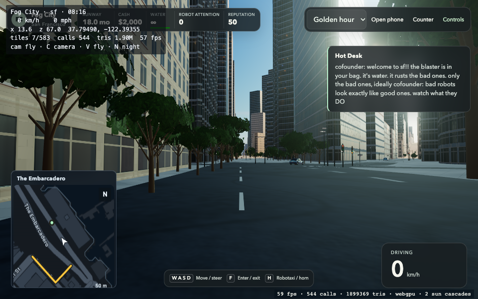
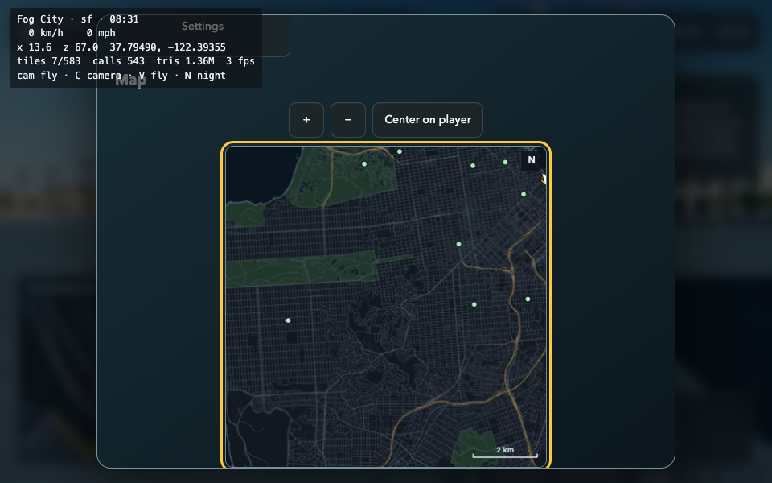
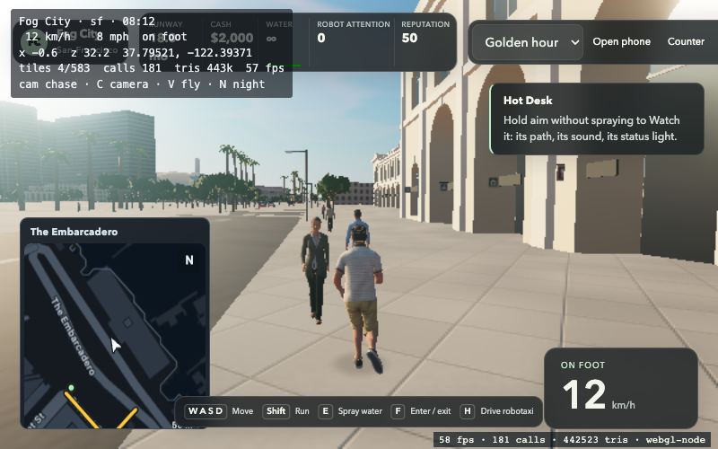
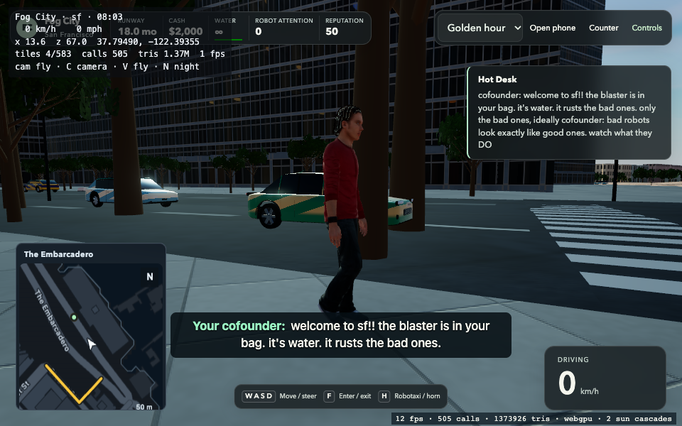

# Targeted Slop New York methods, measured in Fog City

The owner requested Slop New York's stronger driving, graphics, map and rendering methods while retaining San Francisco, Fog City's authored characters, missions and robot interactions. Game code measured here is [b729799a](https://github.com/BroderickHigby/fog-city/commit/b729799a6af9f9810aeb83c97e6c203102bf969c); the comparison baseline is the prior [SIM18 release](https://github.com/BroderickHigby/fog-city/pull/98). Reference source is [be65d0ab](https://github.com/mrdoob/slop-newyork/tree/be65d0ab61b24718b6da8886b7d7bed2d68ac178). No NYC geography, brands, vehicles or characters are imported. The MIT notice remains in the packed build.

## What changed

- **Driving, SIM19.** Reference-style fixed substeps, throttle/power/coasting, speed-sensitive steering, shared tire grip, slip and retained impact momentum operate within Fog City's existing SF terrain, wet traction, full vehicle hull contacts, safe pedestrian dodge and taxi settlement. Chase framing follows horizontal vehicle motion before smoothing. Older saved-version arithmetic stays intact; 39 historical golden/save JSON files are byte-unchanged. New version19 pins and a real version18 save/continuation are separate fixtures.
- **Nearby character continuity.** The old renderer could replace a loaded nearby person with a box avatar when traffic consumed the shared detail/draw allocation. Authored Rocketbox geometry, textures, normals, roughness, hair masking, skinning and clips now share one compact skinned draw per NPC. Human detail is admitted independently before allocating rigid detail, within the existing 27-call ambient-agent budget. The current near cap remains16. All12 real model layouts preserve posed vertices and fit native WebGPU vertex-buffer limits through interleaving. This costs approximately11MiB more prototype texture storage; it is not a blanket memory reduction.
- **Static city rendering.** Streamed tile transforms freeze only after actual parent placement. Opaque, undeformed building casters use position/index-only shadow proxies; alpha, skinned, animated and unknown geometry retains its original path. Hidden-building index edits and unload ownership remain coherent. Static tests measure100 repeated matrix multiplications becoming0 with the same test geometry. Market's seven proxies use251,028 position-attribute bytes versus1,045,950 source-attribute bytes; their complete additional owned buffers are360,126 bytes. These structural savings do not establish a whole-frame speedup.
- **Shader sequencing.** Actual nonzero boot meshes precompile against the scene-pass formats before normal rendering begins. The queue closes afterward; late admissions do not retain jobs or compile concurrently. An attempted incremental async warmup overlapped pinned r186's normal/shadow node construction and caused an OOM. Native diagnosis isolated it by disabling that overlap; the final code removes it. It does not promise to precompile every later streamed layout.
- **SF navigation map.** A spatial index references the already loaded SF geography. Cached, bounded canvas rasters show curved road centerlines, footprints, parks, shoreline, street names, north, scale and the rotating player arrow. The yellow route follows Fog City's directed road graph, including parallel-edge selection. The phone supports zoom, pan, recenter and legal waypoints. No second city, provider or world is loaded.

## Why New York looks richer

Both games already use filtered masonry/windows, parallax room interiors, physical sky/environment lighting, two sun cascades, half-resolution SSR, bloom and one final output conversion. The most visible remaining difference is architectural coverage and composition:

| Source setting/method | Slop New York | Fog City |
| --- | --- | --- |
| Physical architectural detail | Pooled features within560m; capacities include7,000 cornices and1,800 awnings | Nearest36 buildings within140m;90,000 triangles in one draw |
| Massing | Varied lots, courts, wings, whole-storey rooflines and setbacks | Real SF footprints/heights; selective high-building setbacks |
| Ground floor | Explicit shop, residential, rear and party-wall treatments | Five facade families, varied windows and original attachments; broader ground-floor treatment |
| High shadow atlas | 6144×3072 | 4096×2048 |
| Chase field of view | 56° | 62° |
| Near/far people | Custom pose-buffer instanced layers | Existing authored skinned characters, now one draw each |

These are configured capacities, not measured visible counts. NYC's shadow atlas has2.25× the texels. Its longer physical-detail range sustains silhouettes across the street vista. Increasing those settings indiscriminately would add work; preserving SF means applying richer articulation to its own footprints rather than importing Manhattan blocks. Sources: [building pools](https://github.com/mrdoob/slop-newyork/blob/be65d0ab61b24718b6da8886b7d7bed2d68ac178/js/buildings.js#L2149), [detail selection](https://github.com/mrdoob/slop-newyork/blob/be65d0ab61b24718b6da8886b7d7bed2d68ac178/js/buildings.js#L2345), [wall kinds](https://github.com/mrdoob/slop-newyork/blob/be65d0ab61b24718b6da8886b7d7bed2d68ac178/js/tsl-materials.js#L357), [crowd batching](https://github.com/mrdoob/slop-newyork/blob/be65d0ab61b24718b6da8886b7d7bed2d68ac178/js/pedestrians.js#L887).

## Native city measurements

One fresh Chrome155 profile at a time on Apple M4/Metal;960×600, DPR1, golden hour, high, shadows, SSR and bloom. Fog uses300m full-detail streaming plus its far skyline. Simulation stays active. Cameras follow Ferry→Market→100m excursion→Ferry. The same protocol and source/served-byte hashes are retained in the raw local comparison. Reference dev-CDN modules were captured and SHA-pinned; production remains pinned to Three0.186.1.

| Observation | Prior Fog City | Updated Fog City | NYC reference |
| --- | ---: | ---: | ---: |
| Street-view draw calls |546|544|1,009|
| Street-view triangles |1.863M|1.899M|6.48M|
| Street render-submit CPU p50/p95 |6.5/8.7ms|7.0/9.5ms|5.5/6.0ms|
| Mean render-submit p50 across four SF views |6.575ms|6.575ms|Different camera protocol |
| Final engine-tracked allocations |245.8MB|262.8MB|334.8MB at first street view |
| Final CDP JS heap after requested full GC |929.9MB|919.4MB|Different city/workload |
| CDP backing storage, separate accounting |142.7MB|165.9MB|Different city/workload |

There is **no measured overall speed or memory win**. Three r186 versus r187-dev, different cities, shadow sizes, FOVs, visible geometry and live actor states prevent a fair NYC-versus-SF speed ranking. Render-submit CPU time is not GPU execution time. Engine counters, JS heap and backing storage are separate accounting categories, not physical resident RAM; do not sum them into a memory claim. Short camera excursions and one GC snapshot do not prove a plateau or absence of leaks.

The longer map/camera sequence exhausted the deliberately capped1024MB browser at a later cleaning-sign shader. An original SIM18 baseline control also exhausted that cap at the same viewpoint, even without the new zoom/pan UI. The workloads are not identical, so this does not erase the updated build's measured resource increase. Changing only the diagnostic browser cap to1536MB allowed the unmodified candidate to complete the sequence without OOM; shaders remained finite and post-GC JS heap was1,088.1MB, backing167.1MB separately. This is bounded functional evidence at that capacity, **not1GB acceptance or performance-hold clearance**.




## Local verification and limits

At clean b729, Node22 TypeScript passed and the final serial, one-worker focused batch passed **685 tests across64 files**: render227, UI39, content119, sim275 and composed golden25. UI-copy provenance is `fnv1a32:23216b7e`. Separate native component-browser map tests passed6/6. Independent Standards and Spec reviews passed the exact game head.

The native Metal node-WebGL continuity recording uses776 ordinary input frames, a real existing person, high/low replay and chase/first-person/chase changes. Final hash `befd82c9` matches; two visible nearby IDs show zero old-avatar appearances or identity transitions, with agent draws≤27 and no graphics errors. No simulation replacement, forced actors or teleports are used. Geometry/pixel unit tests support the prototype conversion; the native recording checks actual same-tick draw identities.



A separate native WebGPU portrait at1536MB selects the real visible person51 (`crowd:8`) and pauses at tick203. Camera placement leaves simulation hash `009ae3f8` unchanged. The actual4743-vertex skinned body carries color, normal and roughness atlases;26 agent calls,12 loaded crowd models, no graphics errors and no pending/active/failed warmup work. This is a paused appearance probe, not animation timing or FPS acceptance.



Reproduce the local continuity harness against a separately served packed candidate:

```sh
node --max-old-space-size=2048 scripts/qa/avatar-continuity.ts \
  --artifact /absolute/packed-build --url http://127.0.0.1:4371/ \
  --out /absolute/evidence --expect-sha <GAME_HEAD> --assert-modern --quality-replay
```

The packed SF build is190 files/183.7MB, with no source maps, within unchanged450-file/240MB limits. Failed581 and c0fa candidates and the low-cap OOMs are excluded from acceptance. Full raw profiles, module pins, failed attempts, controls and captures remain in the task's local `render-comparison` artifact directory. [Committed compact evidence](evidence/targeted-slop-methods.json) preserves measurements and test summaries.

Hosted CI was intentionally skipped under owner instructions. No billing/settings changed. The inherited allocation/performance hold stays open. These checks are not a green `pnpm verify`, complete browser suite, physical-device reset, whole-city FPS result, long soak or physical RAM plateau.
