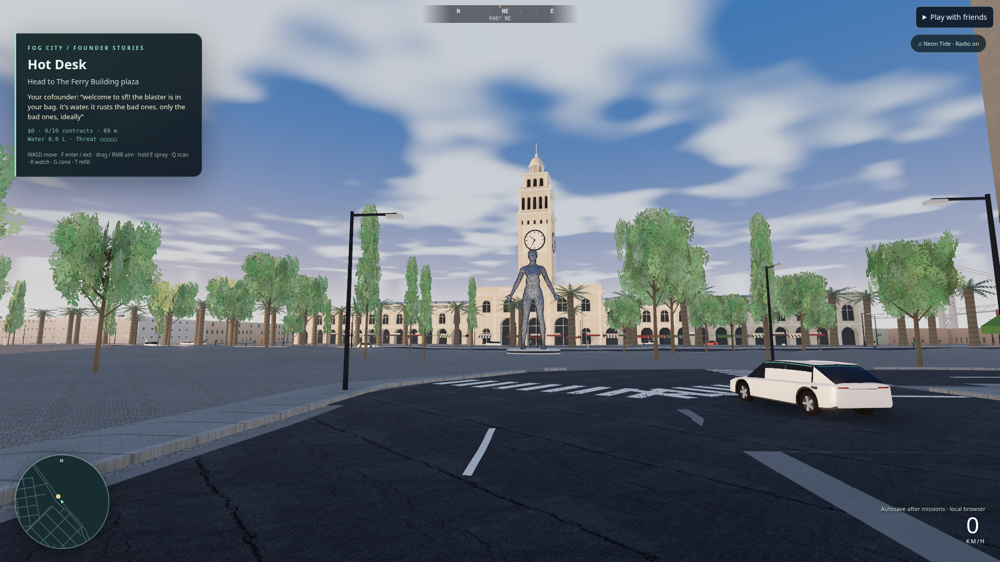

# Active gameplay — packed build, 2026-10-23

Captured from the production bundle at 1920×1080, device/pixel ratio 1, system Chromium with software WebGL. The camera is a debug fly view at local x=-115, z=130, ground+2.2 m, bearing 40°, pitch 7°. This is a reproducible scene view, not a match for the owner's earlier camera or proof of GPU frame rate.

The frame shows the new procedural cloud layer, clear-coated vehicle material, campaign HUD and checkpoint status alongside the previously integrated foliage, Ferry Building and PBR street materials. The associated smoke record confirms packed assets, high graphics, loaded characters, all three lighting presets without simulation-hash changes, successful radio loading and zero browser/HTTP errors.

Visual review: road surfaces and scene composition are improved, but the car silhouette, tree shading, facades and lighting remain visibly below the requested contemporary AAA target. This image records actual output without retouching. Geometry/art replacement and real-GPU profiling remain necessary.
