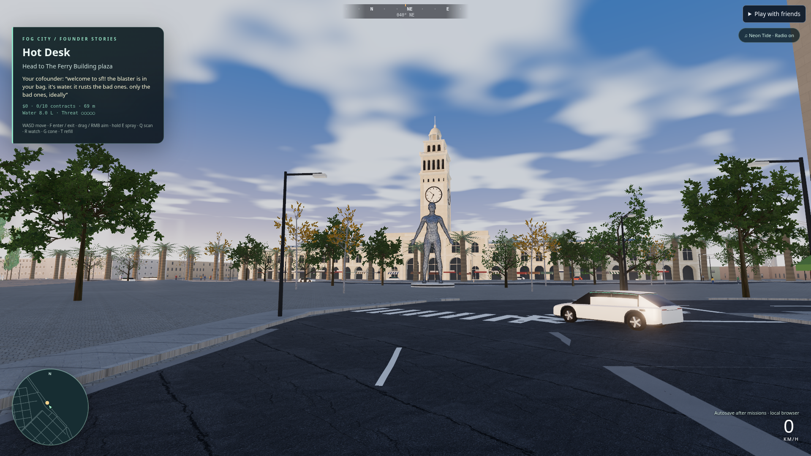

# Latest showcase integration

Unretouched production capture at 1920×1080, pixel ratio 1, golden hour, camera x=-115, z=130, ground+2.2 m, bearing 40°, pitch 7°. System Chromium uses software WebGL. The companion JSON records zero browser/HTTP errors, packed assets, detailed trees and characters, and all lighting presets tested without simulation mutation.

Visual review caught the generator's non-instanced leaf shader and oversized trees; both were corrected before this capture. The clock tower is visible between properly placed canopies. Vehicles, nearby facades and lighting still need work to meet the requested contemporary high-end target. Render statistics include about 5.6 million submitted triangles in this detailed view; this is not a real-GPU performance certification.
